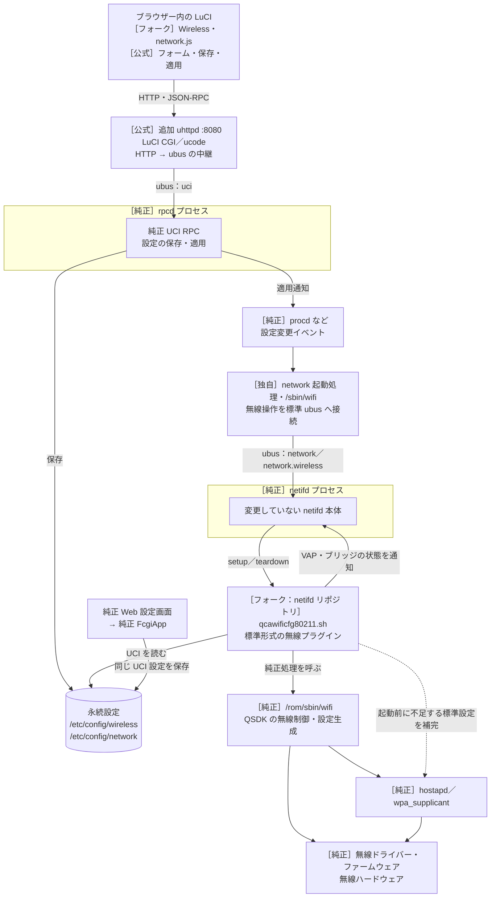
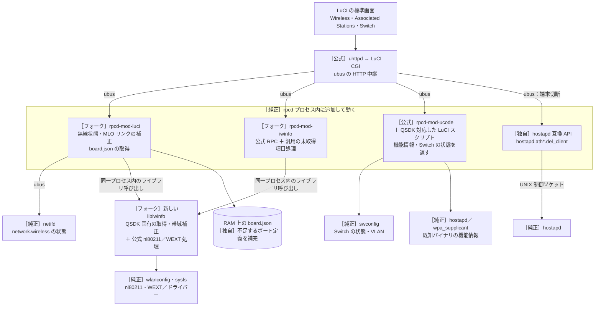
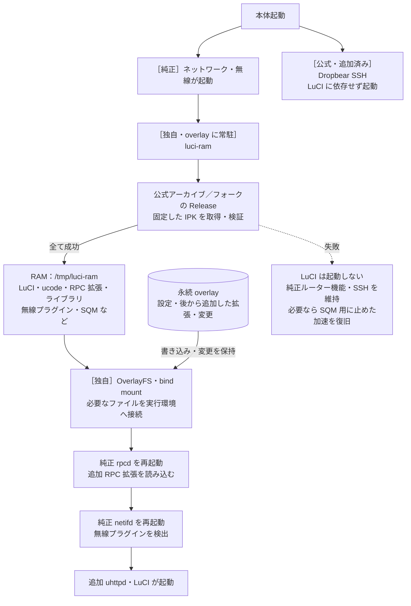
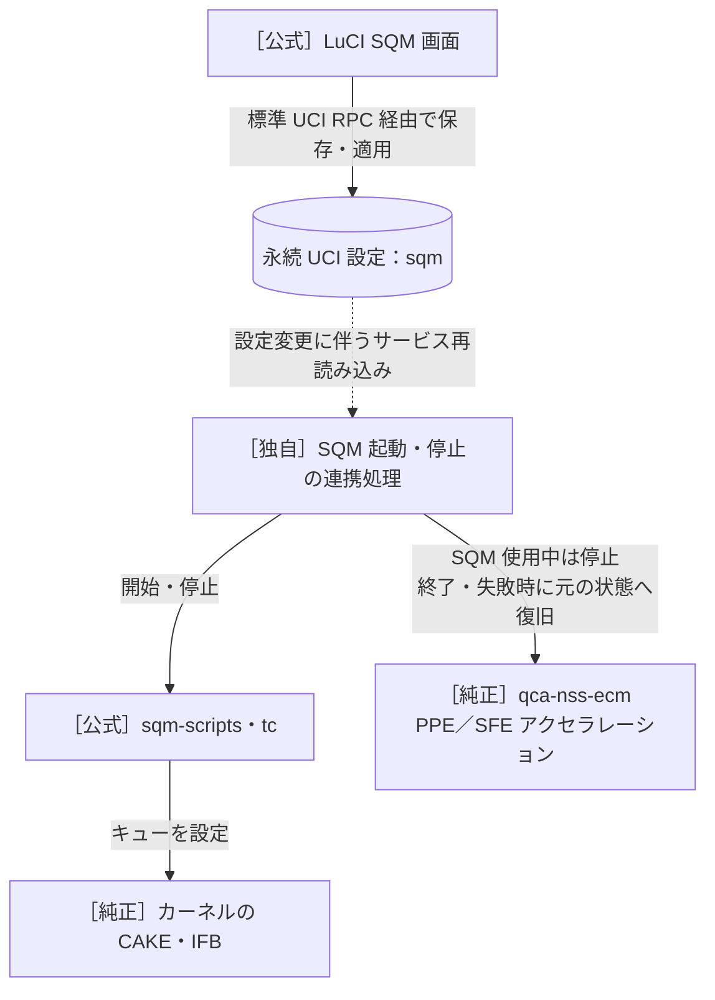

# WN-7T94XR QSDK 対応フォーク

純正ドライバーを使い、LuCI 25.12 の標準 Wireless 画面で AP を管理するためのフォークです。[実装・IPK・導入手順](contrib/wn7t94xr/README.md)を参照してください。

## コンポーネントと呼び出し関係

以下は、純正ファームウェア v2.5.1 上で LuCI 25.12 を動かす `qsdk-25.12` ブランチの構成です。矢印は要求・呼び出しの方向を示し、応答は原則として逆向きに戻ります。ソースに基づく構成図であり、実機の通信トレースではありません。

| 表記 | 意味 |
| --- | --- |
| 純正 | WN-7T94XR のオリジナルファームウェア（QSDK ベース）に元から入っているコンポーネント。 |
| 公式 | OpenWrt／LuCI の公式リポジトリにある実装。本体向けにビルドし直したものも含みます。 |
| フォーク | 公式実装に QSDK 互換対応などの変更を加えたもの。 |
| 独自 | RAM 展開や純正との連携など、この構成のために作った処理。 |

純正コンポーネントにも OpenWrt 由来のコードは含まれます。ここではコードの起源ではなく、本体に元からあるものを使うか、今回追加したものかで区別しています。

### Wireless の設定変更



LuCI 側で設定名・暗号形式を変換し、既存 MLO のリンク間で共有設定を同期します。その後は純正 netifd、追加した無線プラグイン、純正 QSDK 制御処理の順に反映します。netifd リポジトリのフォークから使うのは無線プラグインと `/sbin/wifi` の処理であり、netifd 本体のバイナリは交換しません。

純正 Web 設定画面も同じ UCI 設定を使います。純正画面からの反映経路は API ごとに異なるため、図では共通の保存先までを示しています。

### 無線状態・接続端末・Switch 情報の取得



`rpcd-mod-*` は純正 rpcd が読み込む拡張です。端末切断用の互換 API は `rpcd-mod-luci` に含まれ、同じプロセス内で動きます。別の常駐デーモンは追加しません。図の `ubus` は純正の ubus バスを経由する呼び出しを表します。

新しい `libiwinfo.so.20230701` は LuCI の RPC 拡張が使います。純正プログラムが使う旧 libiwinfo は残し、両者を分けています。既知の純正 hostapd／wpa_supplicant はハッシュで判定し、対応する機能情報を返します。未知のバイナリには公式の機能検査を使います。

QSDK 固有の取得と周波数帯の補正は libiwinfo が担当します。`rpcd-mod-iwinfo` はバックエンド名で分岐せず、libiwinfo が返す取得済み項目のマスクに従い、不明な統計・状態を応答から省きます。マスクを提供しない従来のバックエンドでは、公式と同じ出力を保ちます。不明な MCS・GI の省略と、標準画面が使う `no_ir` の出力も汎用処理として残しており、RPC は公式の無改変版ではありません。

### 起動時の RAM 展開



RAM 展開後も、実際に動く rpcd・netifd 本体は純正バイナリです。追加部分を認識させるために再起動する段階で、通信が一時的に切れます。ダウンロードが完了するまでは純正サービスとマウント構成を変更しません。

### SQM と純正アクセラレーションの連携



通常の通信パケットは LuCI や rpcd を通りません。これらの図は管理・設定用の経路を示しています。実際の転送は純正ドライバー、カーネル、アクセラレーション側が担当します。

### 図の更新

コンポーネントの追加・削除・置き換え、呼び出し先・通信方式、RAM／overlay の配置、起動・停止・失敗時の動作を変更した場合は、同じ変更で該当する図と説明も更新してください。LuCI・iwinfo・netifd のどのフォークを変更した場合も、この README を確認します。図はここで管理し、他の文書からはリンクして参照します。

# OpenWrt luci feed

[](https://hosted.weblate.org/engage/openwrt/?utm_source=widget)

## Description

This is the OpenWrt "luci"-feed containing LuCI - OpenWrt Configuration Interface.

## Usage

This feed is enabled by default. Your feeds.conf.default (or feeds.conf) should contain a line like:
```
src-git luci https://github.com/openwrt/luci.git
```

To install all its package definitions, run:
```sh
./scripts/feeds update luci
./scripts/feeds install -a -p luci
```

## API Reference

You can browse the generated API documentation directly on Github.

Use [ucode](https://ucode.mein.io/) and rpcd for server side operations.

 - [Client side JavaScript APIs](http://openwrt.github.io/luci/jsapi/index.html)

## Development

Documentation for developing and extending LuCI can be found [in the Wiki](https://github.com/openwrt/luci/wiki)

## License

See [LICENSE](LICENSE) file.
 
## Package Guidelines

See [CONTRIBUTING.md](CONTRIBUTING.md) file.

## Translation status

Use [Weblate](https://hosted.weblate.org/engage/openwrt/?utm_source=widget) instead of direct editing of the `*.po` files.

[](https://hosted.weblate.org/engage/openwrt/?utm_source=widget)
